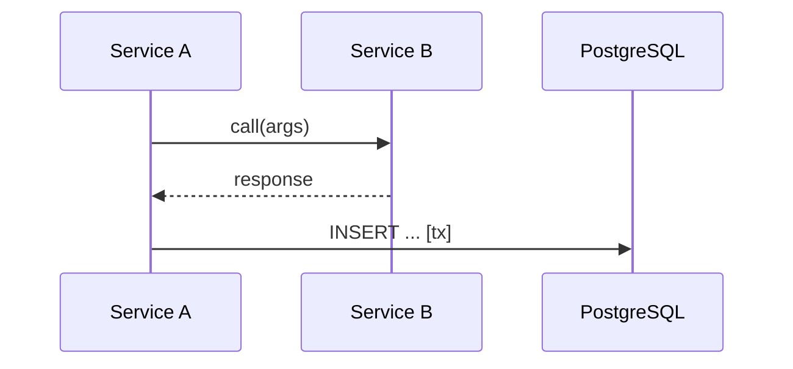

## When to use

| Write SDD                                             | Skip SDD                                        |
| ----------------------------------------------------- | ----------------------------------------------- |
| Significant trade-offs exist between viable approaches | Single-service change with an obvious path      |
| Enough uncertainty that a clear roadmap can't be drafted | Straightforward feature on an established pattern |
| Cross-service contracts or API boundaries being introduced | Bug fixes and minor improvements               |
| Decisions that would be expensive to reverse          |                                                 |

If you can already draft a concrete roadmap without writing the SDD, you probably don't need one.

---

## Principles (read before starting)

### 1. Surface assumptions explicitly

Every design rests on assumptions. Surfacing them is more valuable than hiding them. After each major section, state what you assumed:

```text
ASSUMPTIONS I MADE:
1. [e.g., "User service exposes a bulk endpoint — n+1 calls would be a problem at 20 recipients"]
2. [e.g., "Messages service is idempotent on duplicate sends"]
→ Correct me before we proceed.
```

### 2. Defer non-MVP decisions

For every potential decision, ask: _"Does this need to be decided for v1 to ship, or can it be revisited later without expensive rework?"_

- If it can be deferred → note it as an open question, don't decide it
- If it can't be deferred → document it as a rationale item with alternatives considered
- Aim to minimize the number of locked-in decisions; every extra decision is a future constraint

### 3. Roadmap as vertical slices

A roadmap organized by technical layer (schema → repo → service → handler) makes it hard to see progress and hard to prioritize. Prefer slices that deliver a working, testable vertical of the feature:

**Prefer:**
- "Trigger flow works end-to-end (schema + repo + handler + unit tests)"
- "Polling worker dispatches step 1"
- "Cancel + terminal event flow verified by functional tests"

**Avoid:**
- "All DB schemas and migrations"
- "All repository layer CRUD"
- "All handlers"

Each roadmap item should be independently shippable (or at minimum independently reviewable).

---

## Workflow

### Step 1 — Gather context

Before grilling, collect what exists:

1. Read any requirements docs, idea docs, or tickets the author points to
2. Explore the codebase for: existing patterns, relevant services, DB conventions, proto definitions
3. Check `docs/sdd/README.md` for the next available SDD number

Do not start grilling until you have enough context to ask good questions.

### Step 2 — Grill on design decisions

Ask one question at a time. For each question:
- Explain what's at stake (what breaks or becomes harder with the wrong choice)
- Give your recommended answer with a one-line rationale
- Wait for the author's answer before moving on

**Question order (follow dependencies):**

1. **Deployment model** — single instance or multiple replicas? (affects concurrency choices)
2. **Dispatch/execution mechanism** — polling, job queue, event-driven, or direct call? (biggest architectural decision)
3. **State ownership** — where is state stored, and who owns it? (affects schema and transaction design)
4. **Normalization / resolution timing** — at write time or read time? (affects consistency and dependency coupling)
5. **Failure handling** — fail fast and alert, or retry? If retry, inline or scheduled? (affects schema)
6. **Extensibility points** — in-code config or runtime config? (affects deployment model for new flows)
7. **Cross-service contracts** — what error codes does each dependency failure produce for callers?
8. **Startup behavior** — hard fail or warn on missing dependencies? (affects rollout safety)

For each decision, explicitly test: _"Can this be decided after v1 ships without rework?"_ If yes, skip it and flag it as an open question.

### Step 3 — Determine the next SDD number

Read `docs/sdd/README.md` to find the current highest SDD number. Use the next one.

### Step 4 — Write the SDD file

- Path: `docs/sdd/NNNN-short-kebab-title.md`
- Copy the template from `docs/sdd/0000-template.md` (if missing, create it first as a verbatim copy of this skill's
  [`TEMPLATE.md`](./TEMPLATE.md) with only `<service-name>` replaced)
- Fill every required section (see Section Guide below)

#### Frontmatter reference

```yaml
---
title: "[SDD] Short Descriptive Title"
alias: "short-kebab-title"          # matches filename without the NNNN- prefix
parent: "<service-name>-sdds"       # logical group (e.g. "order-service-sdds")
status: "WIP"                       # WIP → In review → Approved → Deprecated → Superseded | WIP → Rejected
authors:
  - Full Name <email@example.com> # git commit format; find via `git log --format="%an <%ae>"`
collaborators: []                   # contributors who aren't primary authors
reviewers: []                       # people whose approval is required before Approved
created_at: YYYY-MM-DD
review_deadline: YYYY-MM-DD        # created_at + 7 days by default
approved_at:                        # fill when status changes to Approved
epic: PROJ-123                     # Jira epic key, if applicable
---
```

**Title format:** Use a descriptive noun phrase that answers "what is this design for?"

- Good: `"[SDD] Notification Orchestration Core + Approval Flow"`
- Good: `"[SDD] Payment Retry Engine"`
- Bad: `"New service design"` (too vague)

**Status lifecycle:**

```text
WIP → In review → Approved → Deprecated → Superseded
 ↓
Rejected
```

Never edit an Approved SDD's decisions — write a new SDD or an ADR to supersede individual decisions.

### Step 5 — Update the index

Add a row to the table in `docs/sdd/README.md` (create it from [Index README](#index-readme) if missing):

```markdown
| [NNNN](./NNNN-short-kebab-title.md) | Short Descriptive Title | WIP | YYYY-MM-DD |
```

The date is `created_at`. Keep the Status cell in sync with the frontmatter when the status changes.

### Step 6 — Surface final assumptions

After writing the document, state everything you assumed:

```text
ASSUMPTIONS I MADE IN THIS SDD:
1. ...
2. ...
→ Review these before setting status to "In review".
```

---

## Section Guide

### Frontmatter

```yaml
---
title: "[SDD] Short Descriptive Title"
alias: "short-kebab-title"
parent: "<service-name>-sdds"
status: "WIP" # WIP → In review → Approved → Deprecated → Superseded | WIP → Rejected
authors:
  - Full Name <email@example.com>
collaborators: []
reviewers: []
created_at: YYYY-MM-DD
review_deadline: YYYY-MM-DD
approved_at:
epic: PROJ-123
---
```

Use `git log --format="%an <%ae>"` to find the author format.
Set `review_deadline` to `created_at + 7 days` by default.

---

### Input

The background, current state, and context that explains why this design is needed. Write it so a new team member can understand the problem without asking anyone.

Answer: _What is broken or missing today? Why is this decision being made now?_

Keep it to 3–5 sentences.

---

### Requirements

Split into **Functional**, **Non-functional**, and **Out of scope (v1)**. Number Functional and Non-functional items
(`F1`, `NF1`) so Rationale can cite them.

For Out of scope: always include a parenthetical reason: _(deferred — can be added via X without schema change)_ or _(blocked on Y — architecture supports it)_.

Also add a **Vocabulary** subsection defining domain terms used in the document. This prevents reviewers from arguing about words instead of design.

---

### Concerns

Two subsections:

- **Designer concerns** — technical risks the author is worried about (crash safety, silent failure modes, double-sends, etc.)
- **Stakeholder concerns** — what the business or end-user cares about (SLOs, observability, extensibility)

Concerns are not requirements — they're the lens through which reviewers should read the design.

---

### Constraints

Hard limits that shape the solution. Examples: _"User service has no batch endpoint"_, _"service must run as multiple replicas"_, _"email-only in v1"_.

Constraints explain why the obvious solution wasn't chosen.

Number them (`C1`, `C2`). A constraint is true before this design: a limit the Solution itself creates ("two replicas
race on the same job" when replicas are a choice made here) is a consequence, not a constraint. Put it in Rationale
under the decision that creates it, or in Concerns.

---

### Solution

The proposed design. Required subsections:

- **Overview** — 3–5 sentence summary of the approach
- **Data model** — tables/schemas with field-level notes on non-obvious choices
- **[Key flow] flow** — numbered steps for each primary API or operation
- **Sequence diagram** — Mermaid `sequenceDiagram` for any flow with 3+ actors

For sequence diagrams, use:



Include one diagram per non-trivial flow. Do not diagram trivial CRUD.

---

### Rationale

One bullet per locked-in decision. Each bullet must have:
- The decision
- The alternative(s) rejected
- Why the alternative was rejected (concrete, not vague)

Format:

```
- **Decision title (NF2, C1):** reasoning. Alternative X was rejected because [specific downside]. Alternative Y was rejected because [specific downside].
```

The parenthesis names the Requirements and Constraints the decision answers, or `follows from <decision title>` for a
decision that answers a limit another decision created. A decision that only restates a Requirement is not a decision:
say what the design does to meet it.

Keep this section short. If a decision didn't have real alternatives, it doesn't belong here.

---

### Fault Tolerance

For each external dependency (other services, databases, queues):

| Dependency | Failure mode | Impact | Recovery |
|---|---|---|---|
| User service unavailable at trigger | Recipient normalization fails | Trigger returns `UNAVAILABLE` to caller | Caller retries |
| DB unreachable during dispatch | Step cannot be claimed | Worker skips tick, retries next interval | Automatic |

Only include dependencies that are mission-critical. Omit optional/observability dependencies.

---

### Roadmap

Ordered list of vertical slices. Each item should:
- Deliver a testable, reviewable increment
- Include the layers needed to prove it works (schema + logic + tests together)
- Be completable in ≤3 days by one engineer

**Good slice:** _"Trigger flow: schema + repo + handler + unit tests for idempotency and payload validation"_

**Bad slice:** _"All database migrations"_

Number items and note inter-dependencies where they exist (e.g., "3 requires 1 and 2").

---

### Infrastructure

New services, databases, queues, or cloud resources required. If nothing new is needed, write "No new infrastructure required."

---

### Notes

Decisions or discussions from review that are worth preserving but don't fit elsewhere. Add a date prefix: `2026-05-28 —`.

Open questions that are deferred go here too:

```
**Open:** [question] — must be resolved before production. [Why it was deferred.]
```

---

## Decision deferral guide

Use this to decide whether to include a decision in Rationale or defer it to Notes:

| Question | Decision needed in SDD | Can defer |
|---|---|---|
| Which DB to use? | Yes — affects schema and queries | No |
| Polling interval (30s vs 60s)? | No — configurable at runtime | Yes |
| Retry count (3 vs 5)? | No — tunable without schema change | Yes |
| Data retention policy? | No — ops concern, no schema impact in v1 | Yes |
| Notification preferences/opt-out? | No — addable without API change | Yes |
| In-app channel support? | No — channels list already extensible | Yes |
| Exact error message wording? | No | Yes |
| Idempotency key design? | Yes — stored in DB, expensive to change | No |
| Normalization timing (trigger vs dispatch)? | Yes — affects schema and dependency coupling | No |
| Job queue vs polling worker? | Yes — different infra, schema, and ops model | No |

When in doubt: _"If we decide this wrong, how much rework is required to fix it?"_ — if the answer is "one config change" or "one migration", defer it.

---

## Index README

`docs/sdd/README.md` lists every SDD in the repository. Create it with this content when it is missing; `<PREFIX>` is
the service name upper-cased (e.g. `PAYMENTS-API`), `<service-name>` the repository name in lower-case kebab:

```markdown
---
title: "[<PREFIX>] Software Design Documents"
alias: "<service-name>-sdds"
---

# Software Design Documents

Designs for changes with real trade-offs: cross-service contracts, new execution models, decisions that are expensive
to reverse. Write new ones with the `software-design-document` skill, starting from
[`0000-template.md`](0000-template.md).

| # | Title | Status | Created |
|---|-------|--------|---------|
| — | _none yet_ | | |

Status lifecycle: `WIP → In review → Approved → Deprecated → Superseded` (or `WIP → Rejected`). An approved SDD's
decisions are never edited — supersede it with a new SDD or an ADR.
```

Replace the `_none yet_` row with the first real row. Rows are ordered by number.

---

## Review checklist

### Before setting "In review"

- [ ] Every locked-in decision has at least one rejected alternative with a concrete reason
- [ ] Every Rationale bullet cites the Requirement or Constraint IDs it answers (or the decision it follows from)
- [ ] Every Constraint is cited by at least one Rationale bullet, and none is a limit the Solution itself creates
- [ ] Sequence diagrams present for all flows with 3+ actors
- [ ] Out-of-scope items explain *why* they're out of scope and how they'd be added later
- [ ] Roadmap items are vertical slices, not technical layers
- [ ] Fault tolerance table covers all mission-critical dependencies
- [ ] Assumptions listed explicitly (not buried in prose)
- [ ] Vocabulary defined for all domain terms

### During review

- [ ] Could this be simpler with fewer locked-in decisions?
- [ ] Is the roadmap slice order correct given dependencies?
- [ ] Are cross-service contracts explicitly documented (error codes, bulk endpoints)?
- [ ] Are deferred decisions genuinely deferrable (could a wrong default bite us later)?

### After approval

- [ ] Status updated to `Approved`, `approved_at` filled in
- [ ] Row in `docs/sdd/README.md` updated
- [ ] Jira tickets created for roadmap items
