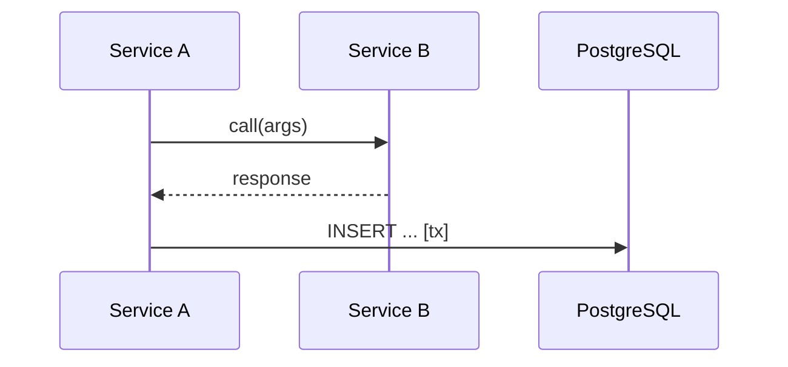

## Input

<!--
3–5 sentences: current state, the problem or gap, and why this decision is being made now.
Write it so a new team member can understand the problem without asking anyone.
-->

## Requirements

### Functional

<!--
- What the system must do.
- One numbered bullet per capability: F1, F2, …
-->

### Non-functional

<!--
- Delivery guarantees, SLOs, extensibility contracts. Numbered: NF1, NF2, …
-->

### Out of scope (v1)

<!--
- List what is explicitly NOT included.
- Always add a parenthetical reason: (deferred — addable via X without schema change) or (blocked on Y — architecture supports it).
-->

### Vocabulary

<!--
Define all domain terms used in this document.
This prevents reviewers from arguing about words instead of design.

- **term** — explanation
-->

## Concerns

**Designer concerns:**

<!--
Technical risks the author is worried about: crash safety, silent failure modes, double-sends, dependency coupling, etc.
-->

**Stakeholder concerns:**

<!--
What the business or end-user cares about: SLOs, observability, extensibility, ops visibility.
-->

## Constraints

<!--
Hard limits that shape the solution. Examples:
- "User service has no batch endpoint — n+1 calls are a latency problem at 20 recipients"
- "Service must run as ≥2 replicas"
- "Email-only in v1"
Constraints explain why the obvious solution wasn't chosen.
Numbered: C1, C2, … Each is true before this design; a limit the Solution creates belongs in Rationale or Concerns.
-->

## Solution

### Overview

<!--
3–5 sentences summarising the approach. Include the key mechanism (polling vs queue, sync vs async, etc.) and the primary data store.
-->

### Data model

<!--
One subsection per table/collection. For each:
- List fields with types and non-obvious notes.
- Call out indexes and why they exist.
- Note any constraints (unique, partial, etc.) with the invariant they enforce.
-->

### [Flow name] flow

<!--
Numbered steps for each primary API operation or background process.
Add a Mermaid sequence diagram for any flow with 3+ actors:

-->

## Rationale

<!--
One bullet per locked-in design decision that had real alternatives.
Format: **Decision title (F1, NF2, C1):** reasoning. Alternative X was rejected because [concrete downside].
The parenthesis cites what the decision answers; every Constraint is cited at least once.

Only include decisions where an alternative was seriously considered.
Omit decisions that had no viable alternative — name the Constraint that forced them instead.
-->

## Fault Tolerance

<!--
For each mission-critical external dependency:

| Dependency | Failure mode | Impact | Recovery |
|---|---|---|---|
| Service X unavailable | ... | ... | Caller retries / ops alert |

Omit optional or observability-only dependencies.
-->

## Roadmap

<!--
Ordered list of vertical slices. Each item should:
- Deliver a testable, reviewable increment
- Bundle the layers needed to prove it works (schema + logic + tests together)
- Be completable in ≤3 days by one engineer

Good: "Trigger flow: schema + repo + handler + unit tests for idempotency and payload validation"
Bad:  "All database migrations"

Note inter-dependencies where they exist (e.g., "3 requires 1 and 2").
-->

1.
2.
3.

## Infrastructure

<!--
New services, databases, queues, or cloud resources required.
If nothing new is needed, write: "No new infrastructure required."
-->

## Notes

<!--
Decisions or discussions from review worth preserving but not fitting elsewhere.
Prefix with date: 2026-05-28 —

Open questions that are deferred:
**Open:** [question] — must be resolved before production. [Why it was deferred.]
-->
