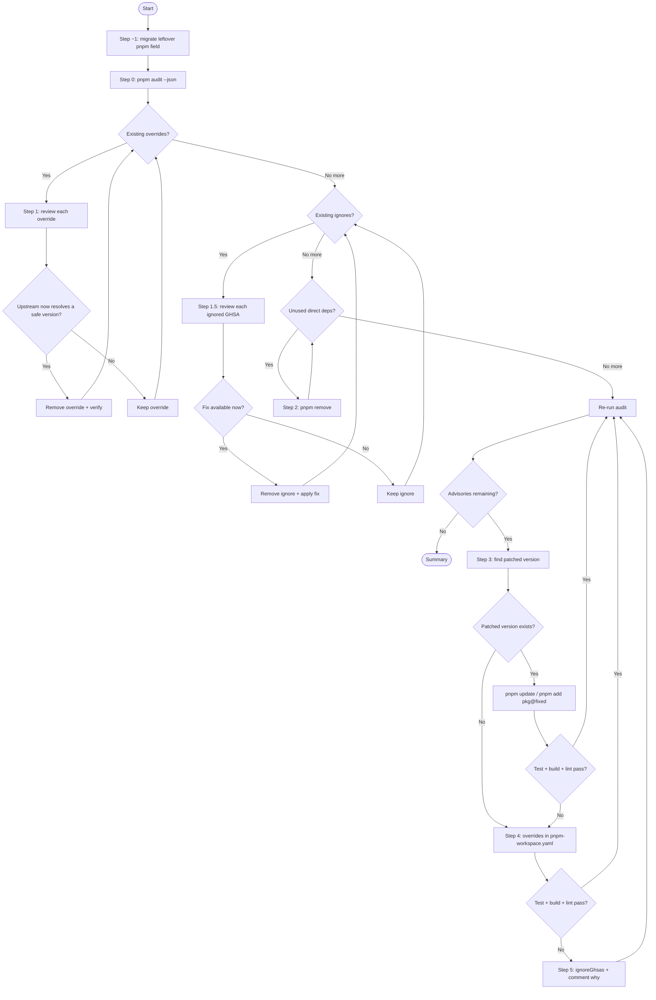

# pnpm Audit Fix

## Goal

Resolve every advisory reported by `pnpm audit` with the safest strategy available for it, preferring direct fixes over workarounds.

## pnpm 12: where things live

pnpm 12 no longer reads the `pnpm` field in `package.json`. Every setting this skill touches lives in **`pnpm-workspace.yaml`** at the project root (the file works in single-package projects too; create it if it does not exist):

```yaml
overrides:
  "minimist@<1.2.6": ^1.2.6

auditConfig:
  ignoreGhsas:
    # GHSA-xxxx-xxxx-xxxx: <package>@<version>. No fix as of YYYY-MM-DD; <why it is not exploitable here>.
    - GHSA-xxxx-xxxx-xxxx
```

Facts this skill relies on:

- **Ignores are by GHSA ID.** The audit report identifies advisories only by `github_advisory_id`; it carries no CVE IDs, so `auditConfig.ignoreCves` no longer suppresses anything. Use `auditConfig.ignoreGhsas`.
- **Notes are YAML comments.** pnpm keeps comments in `pnpm-workspace.yaml` when it rewrites the file, so the reason for each override and ignore goes in a comment right above the entry.
- **`pnpm audit --fix`** writes overrides into `pnpm-workspace.yaml` for every advisory at once, without checking whether a direct update would do. Do not run it (see Rules).
- **`pnpm audit --ignore <GHSA>`** appends the ID to `auditConfig.ignoreGhsas` for you. Add the comment afterwards.

### Step −1 — Migrate a leftover `pnpm` field

If `package.json` still has a `pnpm` field (pnpm prints `The "pnpm" field in package.json is no longer read by pnpm`), its overrides and ignores are **not in effect**. Before anything else:

1. Move `pnpm.overrides` → `overrides` and `pnpm.auditConfig` → `auditConfig` in `pnpm-workspace.yaml`. Move other keys to their documented place ([pnpm.io/settings](https://pnpm.io/settings)).
2. Convert each `ignoreCves` entry to its GHSA ID (search the CVE on [github.com/advisories](https://github.com/advisories) or match it in the audit output) and put it under `ignoreGhsas`.
3. Turn any `"//audit-ignore-notes"`-style companion fields into YAML comments above the matching entry.
4. Delete the `pnpm` field from `package.json`, run `pnpm install`, and confirm the warning is gone.

Tell the user this migration changed what is actually enforced: overrides that were silently ignored now apply again, and the audit result may change.

---

## Flow



## Resolution priority (strict order)

For every advisory, move to the next level only if the previous one is not possible:

1. **Drop the library**: the vulnerable package, or the direct dependency that pulls it in, is unused.
2. **Direct update**: install the minimum version that contains the fix.
3. **Override**: force a safe version of a transitive dependency whose parent has not released a fix.
4. **Ignore the advisory**: add its GHSA to `auditConfig.ignoreGhsas` with a comment saying why. Last resort.

---

## Step 0 — Run the audit

```bash
pnpm audit --registry=https://registry.npmjs.org --json
```

The explicit `--registry` matters when the project or user config points at a private mirror: many mirrors do not implement the audit endpoint. If the user says their registry does, drop the flag in every command below.

The JSON has an `advisories` object keyed by numeric ID. For each advisory, read:

- `github_advisory_id`: the GHSA ID, used for ignores
- `severity`: `critical` / `high` / `moderate` / `low`
- `module_name` and `findings[].version`: the vulnerable package and installed version(s)
- `vulnerable_versions` / `patched_versions`: the ranges, e.g. `>=1.0.0 <1.2.6` / `>=1.2.6`
- `findings[].paths`: dependency paths such as `.>rc>minimist`; the segment after `.` is the direct dependency that pulls it in (in a workspace the first segment is the project path)
- `title` and `url`

Several advisories often hit the same package; the fix must satisfy the highest `patched_versions` among them. Sort the work **critical → high → moderate → low**.

---

## Step 1 — 🛑 Mandatory gate: review existing overrides

> Do not go on to Step 1.5 until every existing override has been checked. An override added as a workaround may no longer be needed once upstream packages update, and stale overrides pin versions silently.

### 1.1 Read the overrides

Read `overrides` in `pnpm-workspace.yaml`.

### 1.2 For each entry

An override such as `"foo@<2.3.2": ^2.3.2` was added because some parent declared a vulnerable `foo` range and had no fix yet. Check whether that is still true:

1. Find the parents:
   ```bash
   pnpm why <overridden-package>
   ```
2. For each parent, check whether a newer release exists and what range it declares now:
   ```bash
   pnpm outdated <parent-package>
   pnpm view <parent-package> dependencies.<overridden-package>
   ```
3. Decide:
   - The installed (or the minimal update of the) parent declares a range whose highest match is safe → **the override is probably redundant**.
   - The parent still pins or caps the package below the patched version → **the override is still needed**.

### 1.3 If it looks redundant

1. Remove the entry (and its comment) from `overrides`. If the parent needs a minor/patch bump to get the safe range, apply it as in Step 3.
2. Run `pnpm install`, then `pnpm audit --registry=https://registry.npmjs.org`.
3. Audit unchanged → keep it removed. A new advisory appears → restore the override.

### 1.4 If it is still needed

Leave it, and add a comment above it naming the parent and advisory if it has none.

---

## Step 1.5 — 🛑 Mandatory gate: review existing ignores

> Do not go on to Step 2 until every ignored advisory has been checked. An ignored advisory may have a fix by now.

### 1.5.1 Read the ignores

Read `auditConfig.ignoreGhsas` in `pnpm-workspace.yaml` and the comment above each entry. If `auditConfig.ignoreCves` exists, it has no effect in pnpm 12: convert it as in Step −1.

### 1.5.2 For each ignored GHSA

Ignored advisories are hidden from the normal audit output. Look the GHSA up on `https://github.com/advisories/<GHSA>` (or `gh api /advisories/<GHSA>` if `gh` is available) to get the package and the patched range. Then:

```bash
pnpm why <vulnerable-package>
pnpm outdated <parent-package>
```

### 1.5.3 If a fix is available now

1. Remove the GHSA and its comment from `ignoreGhsas`.
2. Apply the fix with Step 3 or Step 4.
3. Re-run the audit to confirm.

### 1.5.4 If there is still no fix

Leave the ignore. Update the date in its comment to today so the next review knows it was re-checked.

---

## Step 2 — 🛑 Mandatory gate: remove unused direct dependencies

> Do not go on to Step 3 until every direct dependency has been checked for real usage. Removing an unused package removes its whole vulnerability surface with no risk.

### 2.1 List what to check

All entries in `dependencies` and `devDependencies` of `package.json` (of every workspace project, in a monorepo).

### 2.2 Search for usage

Search the whole repository, excluding `node_modules`, build output and the lockfile. Prefer `rg` when available:

```bash
rg -n --glob '!node_modules' --glob '!dist' --glob '!build' --glob '!pnpm-lock.yaml' \
   -e "from ['\"]<package-name>(/|['\"])" \
   -e "require\(['\"]<package-name>(/|['\"])" \
   -e "import\(['\"]<package-name>(/|['\"])"
```

Without `rg`:

```bash
grep -rnE --exclude-dir={node_modules,dist,build,.git} \
  --include=*.{ts,tsx,js,jsx,mjs,cjs,mts,cts,vue,svelte} \
  "(from|require\(|import\() *['\"]<package-name>(/|['\"])" .
```

Also check places that reference packages without an import:

- config files: `*.config.*`, `tsconfig*.json`, `.eslintrc*`, `.babelrc*`, `.prettierrc*`, `jest`/`vitest` configs (plugins, presets, transformers are often referenced by name only)
- `package.json` scripts, for CLI-only packages (`eslint`, `prettier`, `tsx`, `tsc-alias`, `drizzle-kit`, …)
- `@types/<name>`: needed while `<name>` (or the Node built-in it types) is used
- peer dependencies required by another installed package (`pnpm why <package-name>` shows who depends on it)

### 2.3 Check that the importing code is alive

An import is not enough: the importing file may be dead. For each importing file, search for imports of that file and follow the chain up to an entry point (`main`/`index`, a route or page, an API handler, a config, a script in `package.json`). If the chain breaks, the code is dead.

Signs of dead code:

- nobody imports the file
- it is imported only by other dead files
- it lives in an abandoned feature or a disabled route
- the file is imported but the export that uses the library is never referenced

### 2.4 Decide

- **Zero usage** in source, configs and scripts → `pnpm remove <package-name>`, then re-run the audit.
- **Used only by dead code** → `pnpm remove <package-name>` and delete the dead code. Re-run the audit.
- **Used by live code** → keep it.

> ⚠️ Be conservative. If you are unsure (peer dependency, type-only package, polyfill loaded dynamically, plugin loaded by name), keep it. Remove only with clear evidence of zero usage.

---

## Step 3 — Install the patched version

For each remaining advisory, after re-running the audit:

### 3.1 Find where the fix has to land

- The vulnerable package is a **direct** dependency → update it.
- It is **transitive** → find the direct dependency in `findings[].paths` and check whether a release of it pulls in a patched version:
  ```bash
  pnpm outdated <direct-parent>
  pnpm view <direct-parent>@<candidate-version> dependencies.<vulnerable-package>
  ```
  If such a release exists, update the parent. If none does, go to Step 4.

### 3.2 Install the minimum version that fixes it

Take the target from `patched_versions` (the highest one across all advisories for this package).

**The fix is within the declared range** (`pnpm outdated` shows `Wanted` ≥ the fixed version):

```bash
pnpm update <package>
```

**The fix is outside the declared range** (e.g. range `^2.x`, fix in `3.1.0`):

```bash
pnpm add <package>@3.1.0
```

Keep the dependency type: add `-D` for a devDependency. Do not use `pnpm update --latest`: it jumps to the newest major, past the fix, with unrelated breaking changes. Always target the **minimum version that resolves the advisory**. For a major bump, read the package's changelog for breaking changes before installing.

If the project sets `minimumReleaseAge` in `pnpm-workspace.yaml`, a fix released very recently may be refused. Tell the user rather than lowering the setting; they can wait, or add the package to `minimumReleaseAgeExclude` if they accept the risk.

### 3.3 Verify

```bash
pnpm audit --registry=https://registry.npmjs.org
pnpm run --if-present test
pnpm run --if-present build
pnpm run --if-present lint
```

All pass and the advisory is gone → next advisory. The update breaks something → revert it and go to Step 4.

---

## Step 4 — Override the transitive version

Use this when the vulnerable package is transitive and no release of its parent pulls in a fixed version.

### 4.1 Add a scoped override

Add an entry to `overrides` in `pnpm-workspace.yaml`. Scope the selector to the vulnerable range, so the override stops matching once upstream moves past it, and target the patched version within the same major where possible:

```yaml
overrides:
  # GHSA-xvch-5gv4-984h (critical) via rc@1.2.8; rc has no release with a fixed minimist. Added YYYY-MM-DD.
  "minimist@<1.2.6": ^1.2.6
```

Quote keys that contain `<`, `>`, `|` or spaces. To limit the override to one parent, use `"<parent>>minimist": ^1.2.6`.

### 4.2 Reinstall and verify

```bash
pnpm install
pnpm audit --registry=https://registry.npmjs.org
pnpm run --if-present test
pnpm run --if-present build
pnpm run --if-present lint
```

Works → next advisory. Resolution conflicts or a broken build → revert and go to Step 5.

---

## Step 5 — Ignore the advisory (last resort)

When no fix exists, or every fix breaks the project:

### 5.1 Add the GHSA

```bash
pnpm audit --registry=https://registry.npmjs.org --ignore GHSA-xxxx-xxxx-xxxx
```

or edit `pnpm-workspace.yaml` directly. Do not use `--ignore-unfixable`: it ignores every unfixable advisory at once, without a reason for any of them.

### 5.2 Record why, as a comment

```yaml
auditConfig:
  ignoreGhsas:
    # GHSA-xxxx-xxxx-xxxx: <package>@<version> via <parent>. No fix as of YYYY-MM-DD.
    # Not exploitable here: <server-side only / input never user-controlled / dev tooling only / …>.
    - GHSA-xxxx-xxxx-xxxx
```

If you cannot justify why it is not exploitable, say so to the user instead of writing a reason.

### 5.3 Verify

```bash
pnpm audit --registry=https://registry.npmjs.org
```

---

## After each change — verify and log

After every removal, update, override or ignore, re-run:

```bash
pnpm audit --registry=https://registry.npmjs.org
```

Go on to the next advisory only once the current one is confirmed resolved.

### 🛑 Mandatory: print a step log

After each step, print this before moving on, even when the step changed nothing ("no existing overrides found"):

```
═══════════════════════════════
✅ Step X completed
═══════════════════════════════
Action: <what was done>
Result: <e.g. "3 stale overrides removed", "no changes needed", "GHSA-… fixed via update">
Audit status: X vulnerabilities remaining (Y critical, Z high, W moderate, V low)
Next: Step X.X — <name>
═══════════════════════════════
```

Never move to the next step silently.

---

## Output format

When done, present:

```
🔒 Audit Fix Summary
═══════════════════════════════

🚚 Migrated from package.json "pnpm" field:
   • <keys moved>; ignoreCves converted to ignoreGhsas: <list>

🧹 Stale overrides removed:
   • "<package>@<range>": <version> — <parent>@<version> now resolves a safe version

📦 Previously ignored, now fixed:
   • GHSA-xxxx-xxxx-xxxx — <package> updated to <version>

🗑️ Unused dependencies removed:
   • <package>@<version> — no usage in source, configs or scripts

✅ Fixed (direct update):
   • <package>@<old> → <new> — GHSA-xxxx-xxxx-xxxx (severity)

🔧 Fixed (override):
   • "<package>@<range>": <version> — GHSA-xxxx-xxxx-xxxx (severity)

⏭️ Ignored (no fix available):
   • GHSA-xxxx-xxxx-xxxx — <package>@<version> — reason

Remaining vulnerabilities: X (Y critical, Z high, W moderate, V low)
```

Omit sections with no entries.

---

## Rules

1. **Settings live in `pnpm-workspace.yaml`.** Never add a `pnpm` field to `package.json`; pnpm 12 ignores it.
2. **Ignore by GHSA, never by CVE.** `ignoreCves` has no effect.
3. **Review overrides first** (Step 1) and **ignores second** (Step 1.5). Stale entries get removed, not accumulated.
4. **Remove unused dependencies before patching them** (Step 2).
5. **Always run `pnpm why`** before acting, to understand the dependency chain.
6. **Never run `pnpm audit --fix`.** It overrides everything at once without checking whether a direct update is possible.
7. **Prefer direct updates over overrides, and overrides over ignores.**
8. **Test after every change**: `test`, `build` and `lint` scripts, when they exist.
9. **One advisory (or one package) at a time**; verify before moving on.
10. **Monorepos**: `pnpm-workspace.yaml` at the root holds the overrides and ignores for the whole workspace. Use `-r` (`pnpm -r why`, `pnpm -r outdated`) to look across projects, and `--filter <project>` to update a dependency in the project that declares it.
11. **Use `--registry=https://registry.npmjs.org`** for audit checks unless the user confirms their registry serves audit data.
